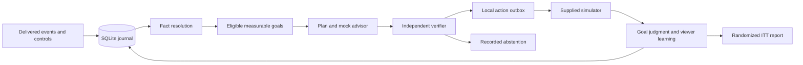

# Architecture and operational contract

## Ownership and flow

`Pack` reads only the supplied local data. `Store` is a SQLite journal. `Engine` owns the viewer's facts, single plan, decisions and outbox. `ReplayProvider` is an untrusted optional advisor. `Verifier` authorizes an action only after independent checks. `replay.run` feeds delivery-ordered events and invokes the supplied simulator. `measure.reports` closes the observational loop and computes user-level randomized estimates.

A partial unique index allows at most one open plan per viewer. Event IDs and decision trigger IDs are unique; a separate user/session uniqueness constraint prevents duplicate pages on different triggers from the same session. Decision, plan and pending action writes share a transaction. The CLI is a single writer; concurrent multi-process serving is intentionally not claimed.

## Facts, provenance and time

The event table retains original JSON, keyed by event ID, with normalized UTC receipt time for indexed queries. The harness ingests historical and live events only at delivery, never preloading future evidence into a viewer. Profile versions are selected by `updated_at` within snapshots already available. Equal-version contradictory profiles resolve to unknown. Every fact includes its value, source, observation time, freshness and resolution rule; disagreements are retained.

The latest fresh app setting available at decision time takes precedence for dialect because it controls which page the app requests; this includes a newer live setting when a trigger waited in a queue. Campaign links are context only. Subscription evidence uses billing events over stale snapshots, preserves positive paid evidence, and marks expired snapshot plans unknown absent renewal. Missing profiles do not become invented signups or consent. Notification opt-outs override snapshot consent.

The phone's absolute clock is untrusted. Estimated occurrence is `received_at - (sent_at - occurred_at)`; negative device durations are invalid. This cancels a constant device clock offset but cannot prove network latency. Events buffered over 600 seconds are retained as history but cannot authorize a live page. A delayed signal can close a goal only if its estimated occurrence is inside the goal window. Observation receipt and estimated occurrence are kept distinct.

“Never” requires signup inside the observed history window and no contradictory positive event. This explicitly relies on feed completeness, so it is recorded as an assumption. A missing event in old, truncated history does not prove lifetime absence.

## Planning, memory and learning

The policy chooses a supported measurable lifecycle goal before ranking content. Goal windows start on commitment, not signup. Continuing a plan preserves its deadline. Success closes it; billing changes can supersede it immediately, with replanning at the next trigger. A goal-rule correction changes only matching open plans through an indexed query, retains deadline and previous success rule, and records the affected plan IDs. Corrections and withdrawals are persisted in runtime metadata for engine restart.

Home-page plans use a hero plus one row with three distinct content slugs. Activation goals use free content; new-release discovery uses the goal's release window. App language and observed viewing genres guide ranking; short episodes are preferred for activation. Description text never enters the advisor or action policy. The planner does not pretend that a publication proves delivery or viewing.

Success evidence changes future eligibility and closes active plans. Failed and unlinked outcomes remain durable per-viewer lessons rather than being treated as conversion evidence. No reinforcement learner or fitted personalization model is claimed.

## Verification and trust boundaries

The verifier independently re-evaluates goal eligibility and rule version, arm, trigger freshness, latency/call budgets, current app dialect, catalogue existence, availability, row shape/type, unique content slug and duplicate session. It reads facts and source events, not the advisor's `eligible` or confidence fields. It can reject the planner. All message types are rejected by this implementation; a provider cannot trigger push or WhatsApp by proposing one. A future channel must implement full consent, quiet-hour, shared cap, copy, price, delivery and template checks before that rejection is relaxed.

Catalogue descriptions, titles, searches and deeplinks are untrusted data. No text is executed, interpreted as system instructions, or used as proof of a billing assertion. Provided model outputs are recorded exactly for audit, but malformed and unsupported claims are not adopted. No hosted model sees the data.

The supplied Python simulator is executed as local assignment tooling. Its generated events are evidence only after generation. Synthetic test fixtures are isolated from the real pack and never used in reported viewer results.

## Latency, faults and recovery

Default ceilings are 60 seconds, 8 model calls and 20 logical data-tool calls. Normal decisions use one model call and at most five logical tool phases: event read, profile/fact hydration, active-plan read, catalogue selection and verification. Journal writes/idempotency checks are control-plane work, outside the configurable data-call budget. Budgets too small for the safe workflow abstain before optional reads. With zero model calls, the local deterministic planner remains usable.

The mock provider reproduces all named outputs and failures. A 45-second provider stall hits a two-second modeled deadline. The supplied model outage returns failures and uses an evidence-only fallback. During the supplied store-degradation window, a stable hash selects 20% timeouts, 5% eight-second slow reads capped by a one-second read deadline, and 75% ten-millisecond reads. Read failures abstain. This distribution is a documented fault-injection model, not observed datastore performance.

Accelerated replay uses a virtual single decision worker. Each decision adds measured service/SQLite time, modeled dependency wait and queue delay. The action timestamp is finalized at the local outbox dispatch boundary after measured decision processing. Event/control ingestion continues before a queued decision starts. If relevant evidence arrives while a modeled dependency call is in flight, pending publication is canceled rather than using the stale snapshot. Availability and deadline are checked again at dispatch. Final local outbox bookkeeping has small unmodeled overhead; no remote publication service is implemented.

SQLite WAL, stable IDs, uniqueness constraints and stored rules support reopening the engine and safely retrying a trigger. CLI replay intentionally starts a new output directory; arbitrary mid-replay CLI resume and distributed exactly-once delivery are not implemented. The JSONL outbox is the simulator publication boundary, not a production messaging system.

## Honest measurement

Goal attainment requires an actual success event in the goal window. `status=succeeded` means the viewer attained the goal, including organic attainment. Individual intervention credit is separate: an observed personalized `home_page_shown` with the plan's action ID and a later same-session success is an association; no exposure or unlinked success yields an inconclusive intervention judgment. Neither temporal ordering nor a confident model proves individual causation.

The primary replay endpoint is any episode completion within 72 hours of first fresh trigger delivery, selected before simulation and applied to all enrolled viewers in both randomized arms regardless of action, goal, exposure or success. The exploratory secondary endpoint is paid purchase within seven days. Windows must mature before a negative result is counted. ITT risk differences use unpaired Newcombe/Wilson 95% intervals at the randomized viewer level.

The prior pilot is analyzed using assignment, retaining unserved treatment viewers. Served versus everyone else is included only as a labeled noncausal demonstration of selection bias. Goal-specific adaptive success rates are descriptive, not the primary causal estimator.

## Scaling discussion

For 1,000 opens/minute, partition by viewer ID, serialize each viewer's mutations, and use transactional outbox consumers with idempotency keys. Cache versioned immutable catalogue indexes by dialect and availability, while preserving independent verification. Admission control should return explicit abstentions before the SLA is exceeded. A provider circuit breaker can remove optional calls during outages. For 10 million viewers, replace single-writer SQLite with partitioned durable state and event-log offsets, and target rule migrations by active-goal indexes. These are design recommendations, not implemented load-test results.
